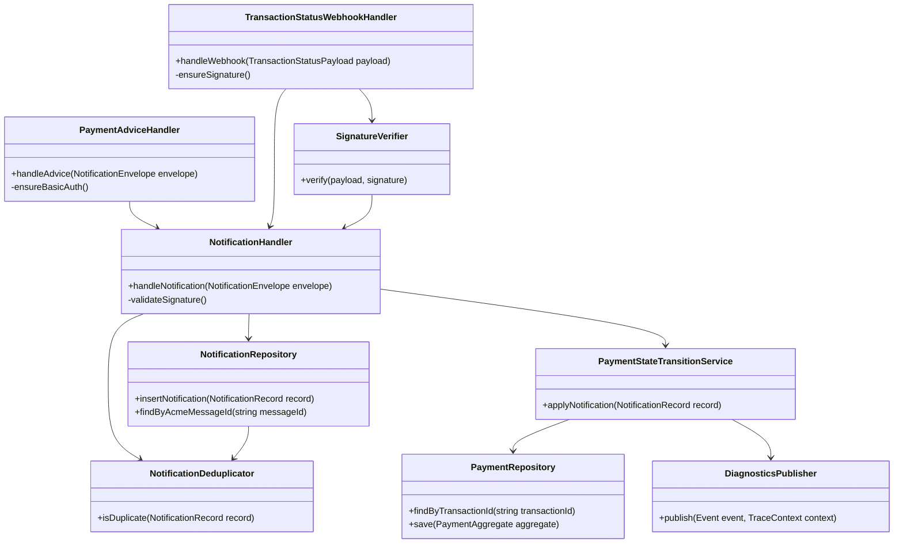
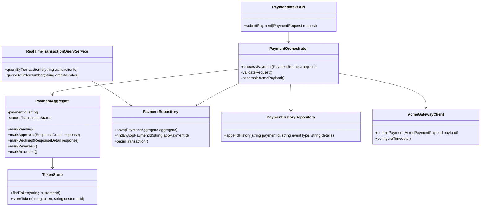
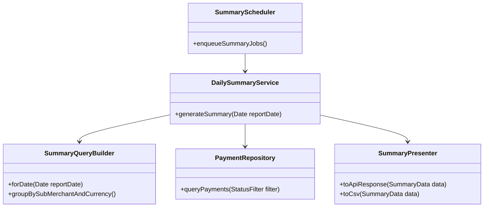

# Object-Oriented & Adaptive Design Workspace

This directory will host artifacts generated in Phase 2 (Object-Oriented analysis and design) and Phase 3 (Adaptive/iterative refinement). At present, we are concluding the Structured Systems Analysis and Design phase with the diagrams in `../analysis`. Once a stack and architecture direction is chosen, we will:

1. Derive OO model candidates (classes, interfaces, ports/adapters) from the ERD and DFD.
2. Map sequences to service operations, handlers, and DTOs while keeping SOLID, DRY, and ACID principles front-of-mind.
3. Iterate adaptively, validating fit-for-purpose choices against the ISO/IEC 25010 quality attributes and 12-Factor operations vector.

Leave this README as the central plan for our next analyses.
# Adaptive Analysis & Design (Phase 3)

Phase 3 bridges the stack-agnostic OO model into an implementation blueprint through iterative validation and incremental refinement. This layer of work keeps all previously captured artifacts relevant, while ensuring each component can be safely realized with concrete technologies that preserve our guiding principles (ISO/IEC 25010, ACID, SOLID, DRY, 12-Factor).

## Goals for this phase

1. **Technology mapping** – for each domain service (payment, notification, summary) confirm the concrete frameworks, libraries, and deployment targets we will use. The mapping documents how we will:
   - Persist the ERD entities with SQL migrations and ORM/data access layers.
   - Implement the DFD flows using async APIs, background workers, or pub/sub if needed.
   - Tie the sequence diagrams into endpoint contracts, retry policies, and authentication requirements (Acme Payment Advice Basic Auth, Transaction Status webhook HMAC validation, Real Time Transaction Query).
2. **Resilience tuning** – specify how the adaptive design handles timeouts, retries, circuit breakers, and backpressure by:
   - Defining invariants for `PaymentAggregate` so state transitions stay consistent under duplicate or out-of-order notifications.
   - Ensuring `AcmeGatewayClient` can be swapped between stubbed and live deployments while conserving instrumentation for diagnostics.
   - Guaranteeing the Notification subsystem acknowledges each delivery (200 on success, 401/400 on invalid auth or signature) and replays the exact payload when Acme retries after failures.
3. **Instrumentation & compliance checks** – choose logging/metrics/health checks that confirm observability expectations from ISO/IEC 25010 and 12-Factor. This includes:
   - Emitting structured logs for every payment lifecycle event.
   - Exposing health/readiness endpoints and hooking them into diagnostics modules already outlined in [structured-systems-analysis.md](../analysis/structured-systems-analysis.md).
4. **Iterative validation** – define a lightweight validation loop that cycles through:
   - Reviewing each Mermaid diagram for consistency with the chosen stack.
   - Confirming ACID-enforcing transactions exist (e.g., via pseudo-SQL or migration snippets).
   - Planning safety nets (idempotency, deduplication, telemetry) before coding.

## Outputs

- ✅ A refined implementation plan showing how each class/repository ties to the chosen .NET 8 stack, container configuration, and SQL persistence strategy.
- ✅ Documented trade-offs for scaling and observability, ensuring the adaptive approach stays flexible (e.g., injecting alternate storage for the token store, instrumenting Summary Scheduler to avoid load spikes).
- ✅ A checklist for the next sprint that ensures the structured analysis artifacts remain the source of truth as we start coding.

Phase 3 is the final preparatory layer before implementation: it converts our abstract models into runnable modules while honoring the quality, reliability, and operational commitments in [soul.md](../../soul.md).
# Notification Domain Classes

## Notes

- Notification processing is split into validation, persistence, deduplication, and payment-state application to keep each class focused (SOLID).
- `PaymentAdviceHandler` (basic auth) and `TransactionStatusWebhookHandler` (HMAC signature verification via `SignatureVerifier`) share the `NotificationHandler` workflow once authentication/validation succeeds, ensuring identical downstream behavior for advice vs. internal switch events.
- `NotificationDeduplicator` keeps retry handling safe, allowing multiple identical callbacks without violating ACID constraints.
- `DiagnosticsPublisher` captures ISO/IEC 25010 maintainability signals by emitting structured traces for each state change, enabling later observability instrumentation.
- Mermaid `classDef` styling highlights how each handler, verifier, and repository contributes to the notification flow, keeping the diagram consistent with the rest of the analysis assets.
# Object-Oriented Analysis & Design (Phase 2)

Phase 1 gave us the DFDs, ERDs, and sequence diagrams that expose the major flows: payment submissions, notification handling, and daily reporting. Phase 2 now translates those flows into domain-aligned objects, services, and collaborators while staying stack-agnostic. We continue to honor the principles captured in `Soul.md` (ISO/IEC 25010 quality goals and ACID/SOLID/DRY/12-Factor commitments) while preparing for later adaptive refinements. Every diagram uses the Context7-sourced Mermaid theme so colors, contrast, and typography stay cohesive across the analysis artifacts.

## Domain services and responsibilities

1. **Payment processing module**  
   - Intake point is `PaymentIntakeAPI` (controller/handler) responsible for validating the payload and correlating the App payment ID.
   - `PaymentOrchestrator` acts as the use-case runner: it instantiates `PaymentAggregate` state, coordinates writes to `PaymentRepository` and `PaymentHistoryRepository`, and dispatches the Acme request through `AcmeGatewayClient`.
   - `PaymentAggregate` encapsulates the payment state machine (Pending → Approved/Declined → Reversed/Refunded) and exposes commands such as `markApproved()`, `applyNotification()`, and `recordFailure()`, enforcing invariants (SOLID Single Responsibility, encapsulated behaviors).
   - `TokenStore` provides idempotent token lookups, and `IdempotencyGuard` (possibly part of the repository layer) ensures replayed requests reuse existing aggregate state.

2. **Notification handling module**  
   - `NotificationHandler` validates the incoming envelope, authenticates Acme (HMAC/Basic auth), and persists the raw payload through `NotificationRepository`.
   - `NotificationDeduplicator` interprets `AcmeMessageID` and `TransactionID` to short-circuit duplicates before state changes are applied.
   - `PaymentStateTransitionService` orbits the `PaymentAggregate`, applying updates transactionally and emitting `PaymentHistory` entries for auditability.
   - Observers/listeners (e.g., `DiagnosticsPublisher`) can capture correlation IDs and diagnostics metadata at each transition.

3. **Summary/reporting module**  
   - `SummaryScheduler` or a cron trigger drives `DailySummaryService`.
   - `DailySummaryService` queries aggregated views (e.g., using `SummaryQueryBuilder`) to fetch counts/totals per sub-merchant and currency, respecting the `Payment` statuses.
   - `DailySummaryPresenter` optionally renders API responses or exports structured JSON/CSV while ensuring calculations are deterministic (12-Factor reprensentations, e.g., environment-driven timezone).

4. **Infrastructure/utility layer**  
   - `Configurations` are provided via environment-backed factories (12-Factor Config).  
   - `AcmeGatewayClient` wraps HTTP calls with concurrency management (circuit breakers/throttling) and ensures any `HttpClient` or `SqlConnection` is shared or pooled.
   - `DiagnosticsLogger` records results per ISO/IEC 25010 reliability, emitting structured logs and metrics for tracing.
5. **Supporting entry points**
   - `RealTimeTransactionQueryService` surfaces the `/apirttq/query` endpoint so the App can reconcile timed-out requests without resubmitting.
   - `PaymentAdviceHandler` and `TransactionStatusWebhookHandler` are specialized `NotificationHandler` implementations that enforce the correct authentication (basic vs. HMAC) before delegating to the shared notification flow.

## Object-oriented diagrams

- [Payment domain classes](./payment-domain-classes.md)
- [Notification domain classes](./notification-domain-classes.md)
- [Summary domain classes](./summary-domain-classes.md)

Each diagram is intentionally focused on a component so we can extend, validate, and iterate (Phase 3 adaptive design) without inflating a single file. They also expose the hooks required for later dependency injection, composition, testing, and SOLID-friendly refactors.
# Payment Domain Classes

## Notes

- `PaymentIntakeAPI` is the entry controller; it is thin (Single Responsibility) and only marshals requests to the orchestrator.
- `PaymentOrchestrator` orchestrates validation, persistence, and gateway interaction while keeping `PaymentAggregate` pristine (DRY across status transitions).
- `PaymentRepository` and `PaymentHistoryRepository` pair in a single ACID transaction so the payment and audit trail move together, satisfying ISO/IEC 25010 reliability.
- `RealTimeTransactionQueryService` reuses the same repositories to answer `/apirttq/query` lookups and prevents duplicate submissions resulting from timed-out calls.
- `TokenStore` is an injected dependency that can be swapped for a caching tier or a shared SQL table; this keeps the design open for future scaling.
- Controllers, services, repositories, and support components are deliberately color-coded via Mermaid `classDef` styling so the diagrams remain legible when we export them for reviews or embed them in the final solution doc.
# Summary & Reporting Domain Classes

## Notes

- Summaries are read-only operations that query the payment store without altering state, ensuring ACID writes remain unaffected.
- `DailySummaryService` aggregates by `TransactionStatus` categories defined by the ERD, meeting the business requirements (approved, declined, reversed, refunded).
- Presentation is abstracted so we can add REST, GraphQL, or downstream exports (DRY across output formats).
- The Mermaid styling keeps the scheduler, query builder, and presenter visually distinct so the reporting flow can be read at a glance.
