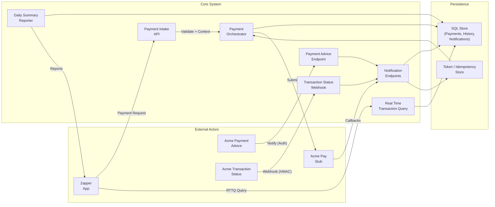
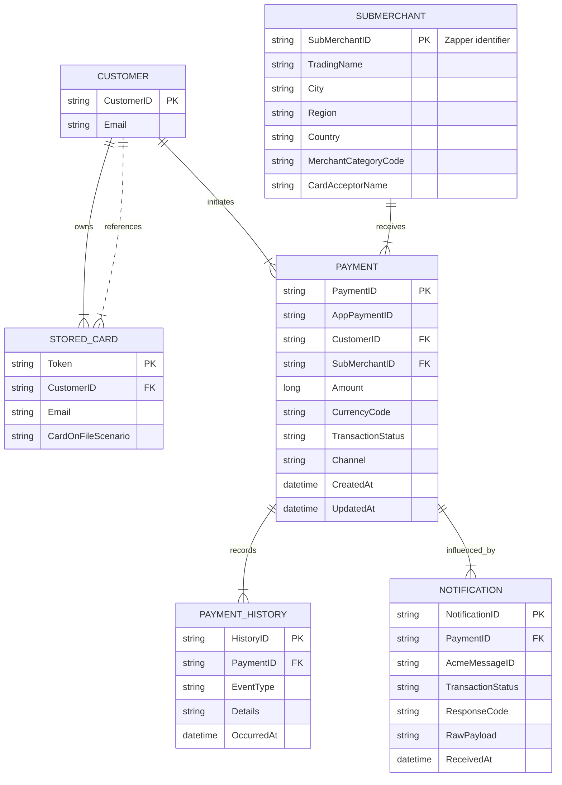
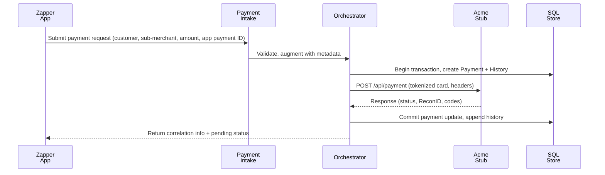
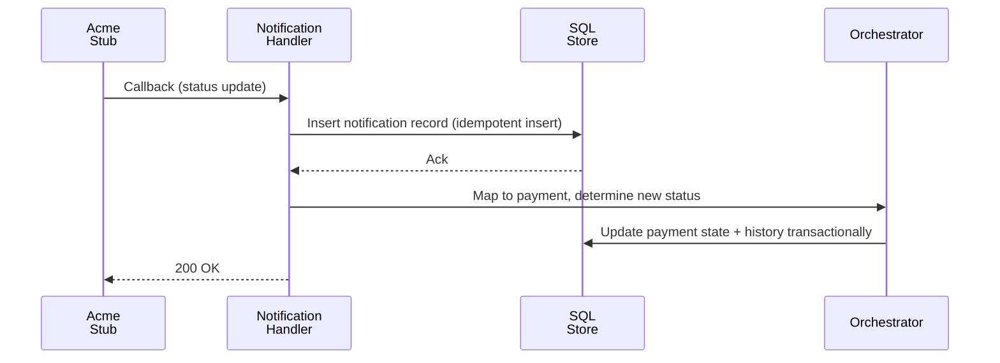
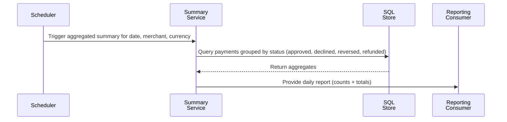
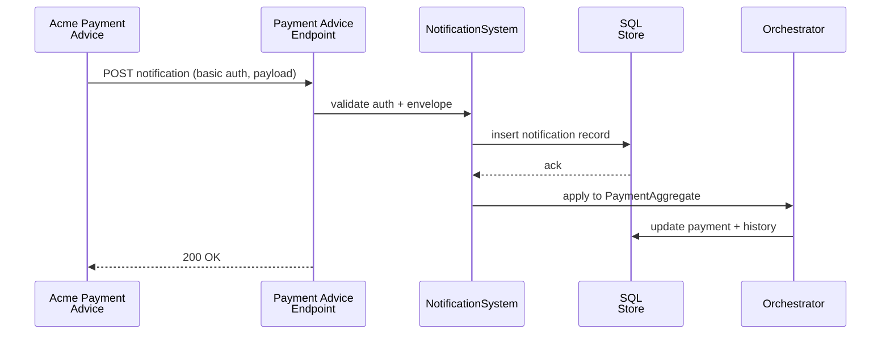
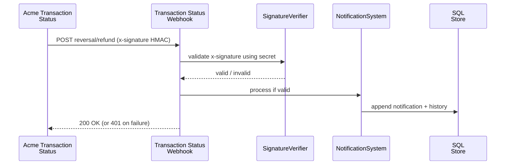
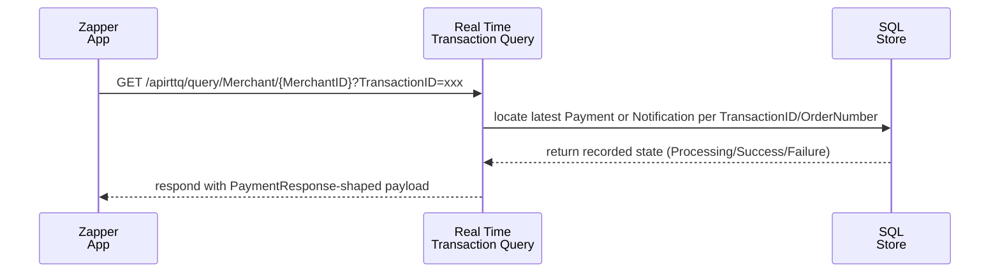

# Data Flow Diagrams (DFD)

## Level 0 - Payment acceptance system

## Notes

- **Data stores** keep audit records and tokens separate to maintain ACID guarantees (transactions update `Payment` + `PaymentHistory` atomically); the color legend differentiates actors, system responsibilities, and persistence surfaces.
- **Notification flow** writes to a ledger-style record before emitting state transitions so retries stay idempotent; the Payment Advice and Transaction Status endpoints share the same handler after authenticating via basic auth or HMAC, respectively.
- **Real Time Transaction Query** lets the App reconcile timed-out submissions without resubmitting, ensuring append-only histories remain consistent while the service reports deterministic outcomes.
- **Summary service** reads the shared stores in a read-only fashion, keeping ISO/IEC 25010 reliability and performance expectations in focus.
# Entity Relationship Diagram (ERD)

## Notes

- Every write to `PAYMENT` pairs with a `PAYMENT_HISTORY` entry to satisfy audit and ACID requirements; the colored class legend separates operational tables from auditing tables.
- Notifications live in their own table so retries accumulate without mutating prior rows, supporting the ISO/IEC 25010 reliability expectation.
- This schema remains intentionally minimal to keep the analysis phase stack-independent while still highlighting normalization and indexing for the next iterations.
# Sequence Diagrams

## 1. Payment submission flow

## 2. Notification dedup/reordering

## 3. Daily summary generation

## 4. Payment Advice notification

## 5. Transaction Status webhook (Reversals/Refunds)

## 6. Real-time transaction query

## Notes

- Each diagram is kept small so sub-components can later author their own focused diagrams when we proceed with OO design.
- State transitions rely on idempotent inserts and transactional histories, satisfying ACID and ensuring maintainable, traceable behavior per ISO/IEC 25010.
- Real-time queries reuse the same persistent models to avoid resubmitting timed-out requests and present consistent TransactionStatus.
- All sequence diagrams share the same base theme (Inter font, muted edges, deliberate accent colors) so the flow of time appears cohesive across payment, notification, and reporting scenarios.
# Structured Systems Analysis & Design Phase

This phase remains deliberately stack-agnostic. We are exploring the problem space through data flows, entities, and interactions before selecting languages, frameworks, or an architectural stance. The goal is a modular, high-level design made of independent components that can later be mapped to OO or adaptive patterns.

## Phase deliverables

- **DFD** describing how payments, notification callbacks (payment advice + transaction status), real-time transaction queries, and summaries move through the system and its supporting data stores. _(See [DFD](./dfd.md))_
- **ERD** capturing the persistent model for merchants, cards, payments, and history. _(See [ERD](./erd.md))_
- **Sequence diagrams** that show the lifecycle of a payment request, notifications (including the payment advice webhook and the transaction status webhook), real-time transaction queries, and the daily summary generation. _(See [Sequence diagrams](./sequence.md))_

## High-level component overview

1. **External interfaces**
   - **Payment Intake API**: accepts customer, sub-merchant, and amount. Responsible for request correlation and validation.
   - **Notification endpoints**: publicly reachable handlers that authenticate Acme callbacks, deduplicate, and emit state transitions.
   - **Summary/reporting surface**: exposes per-merchant daily summaries either via API or query.
2. **Core coordination**
   - **Payment orchestration**: builds Acme request, records intent, updates payment status, and surfaces diagnostics.
   - **Acme stub**: imitates the payment gateway with configurable delays, reordering, and idempotency safeguards.
   - **Durable persistence**: applies ACID principles, stores audit trails, and ensures notifications land in a consistent, append-only ledger.
   - **Real Time Transaction Query service**: exposes the `/apirttq/query` pattern so the service can reconcile timed-out submissions and keep outcomes consistent.

3. **Supporting services**
   - **Idempotency/token store** for ensuring retries are safe.
   - **Diagnostics/logging module** that captures correlation IDs, message headers, and environment context for troubleshooting.

## Compliance & guiding constraints

This analysis already keeps ISO/IEC 25010 quality attributes top-of-mind (functional suitability, reliability, performance efficiency, security, maintainability, etc.). The resulting architecture must be extendable into SOLID/DRY responsibilities once we choose a stack, and remain compatible with 12-Factor deployment targets.

The Notification subsystem also covers both **Payment Advice** (basic auth) and **Transaction Status webhooks** (HMAC signatures + retries) so replayed or out-of-order updates stay idempotent. The diagrams now use a coherent style guide derived from Context7-sourced Mermaid class definitions so colors, fonts, and accents reinforce the roles and data paths.

For the next phase we will do Object Oriented analysis and design, referencing these artifacts to derive classes, interfaces, and adapters before validating with an adaptive design approach. The working area for that transition is documented in `docs/design/README.md`.
