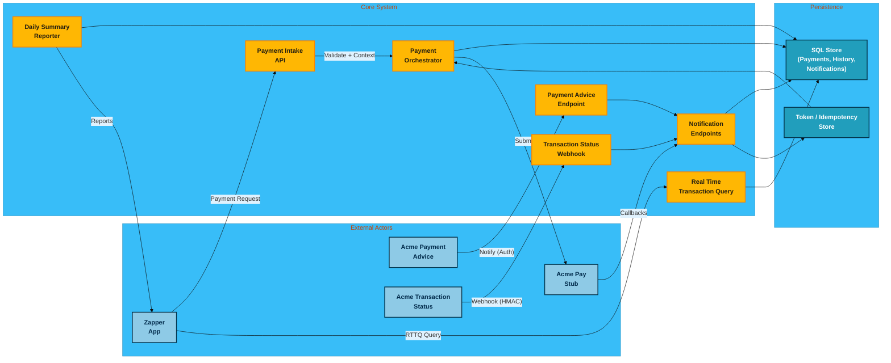

# Data Flow Diagrams (DFD)

## Level 0 - Payment acceptance system

## Notes

- **Data stores** keep audit records and tokens separate to maintain ACID guarantees (transactions update `Payment` + `PaymentHistory` atomically); the color legend differentiates actors, system responsibilities, and persistence surfaces.
- **Notification flow** writes to a ledger-style record before emitting state transitions so retries stay idempotent; the Payment Advice and Transaction Status endpoints share the same handler after authenticating via basic auth or HMAC, respectively.
- **Real Time Transaction Query** lets the App reconcile timed-out submissions without resubmitting, ensuring append-only histories remain consistent while the service reports deterministic outcomes.
- **Summary service** reads the shared stores in a read-only fashion, keeping ISO/IEC 25010 reliability and performance expectations in focus.
