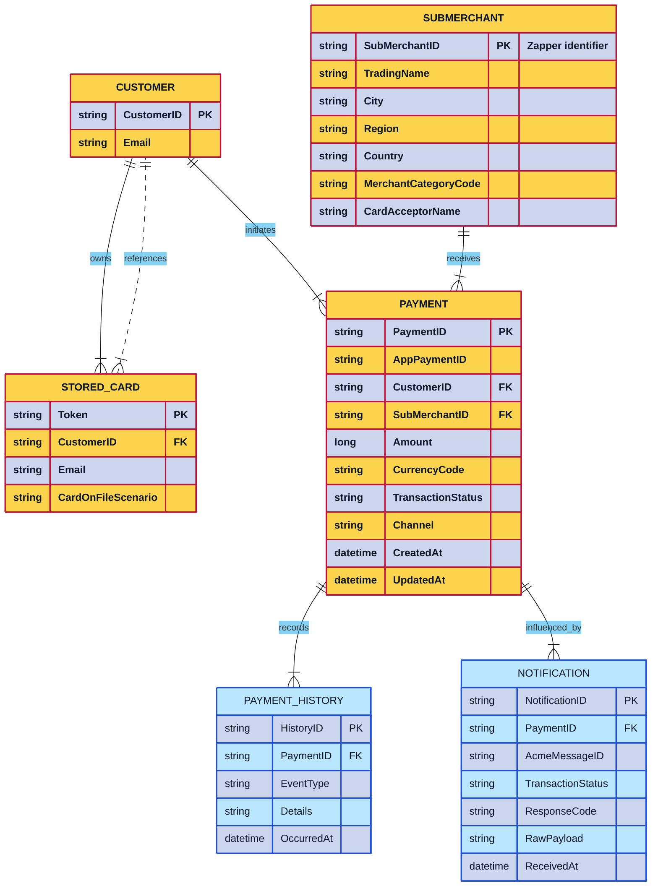

# Entity Relationship Diagram (ERD)

## Notes

- Every write to `PAYMENT` pairs with a `PAYMENT_HISTORY` entry to satisfy audit and ACID requirements; the colored class legend separates operational tables from auditing tables.
- Notifications live in their own table so retries accumulate without mutating prior rows, supporting the ISO/IEC 25010 reliability expectation.
- This schema remains intentionally minimal to keep the analysis phase stack-independent while still highlighting normalization and indexing for the next iterations.
