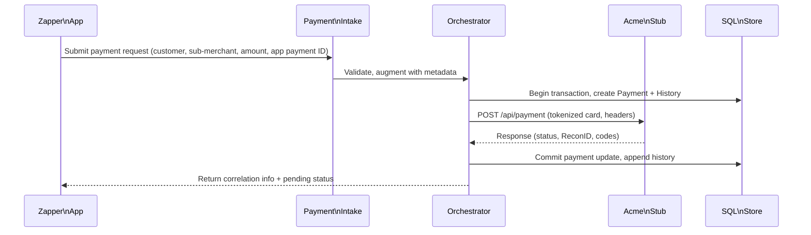
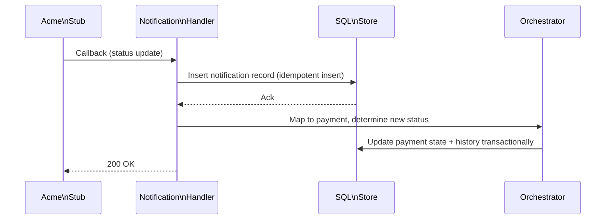
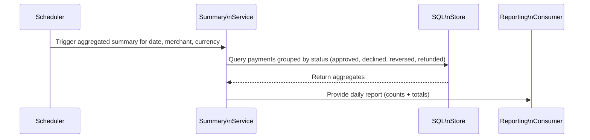
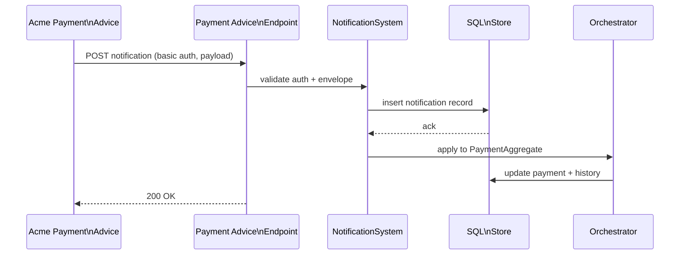
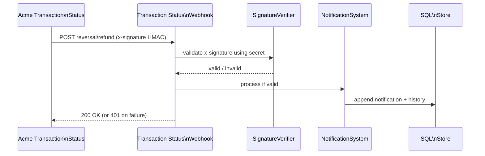
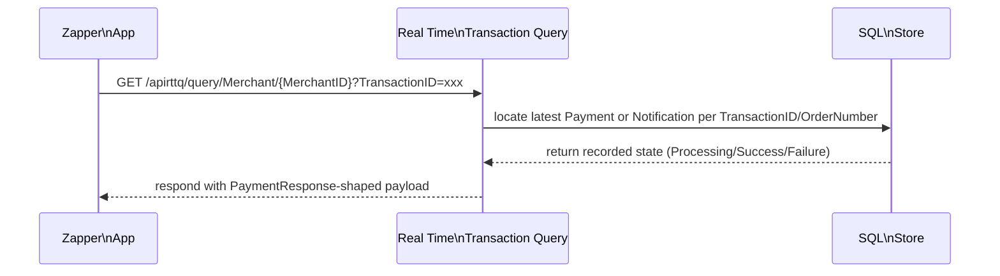

# Sequence Diagrams

## 1. Payment submission flow

## 2. Notification dedup/reordering

## 3. Daily summary generation

## 4. Payment Advice notification

## 5. Transaction Status webhook (Reversals/Refunds)

## 6. Real-time transaction query

## Notes

- Each diagram is kept small so sub-components can later author their own focused diagrams when we proceed with OO design.
- State transitions rely on idempotent inserts and transactional histories, satisfying ACID and ensuring maintainable, traceable behavior per ISO/IEC 25010.
- Real-time queries reuse the same persistent models to avoid resubmitting timed-out requests and present consistent TransactionStatus.
- All sequence diagrams share the same base theme (Inter font, muted edges, deliberate accent colors) so the flow of time appears cohesive across payment, notification, and reporting scenarios.
