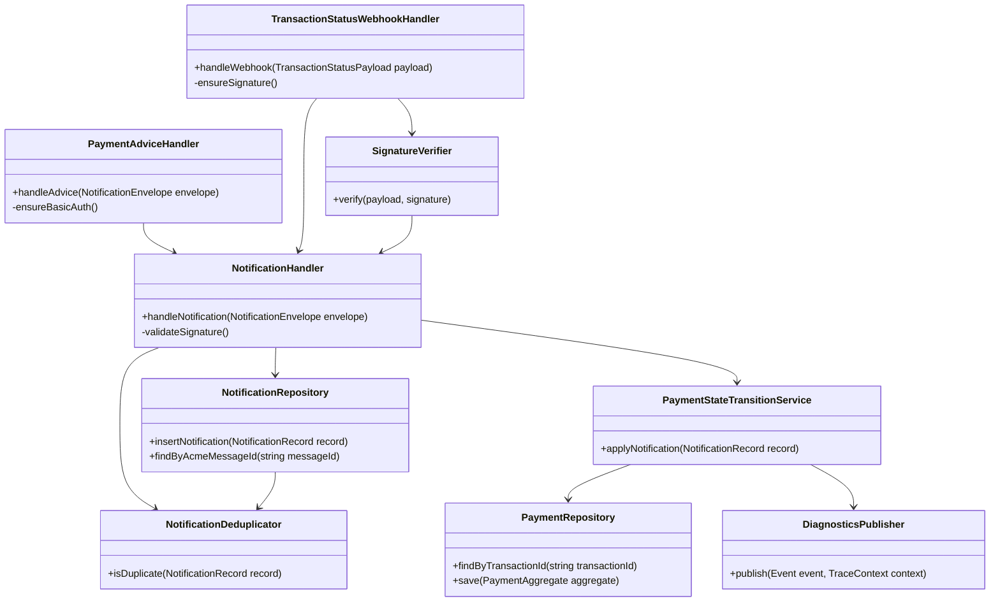

# Notification Domain Classes

## Notes

- Notification processing is split into validation, persistence, deduplication, and payment-state application to keep each class focused (SOLID).
- `PaymentAdviceHandler` (basic auth) and `TransactionStatusWebhookHandler` (HMAC signature verification via `SignatureVerifier`) share the `NotificationHandler` workflow once authentication/validation succeeds, ensuring identical downstream behavior for advice vs. internal switch events.
- `NotificationDeduplicator` keeps retry handling safe, allowing multiple identical callbacks without violating ACID constraints.
- `DiagnosticsPublisher` captures ISO/IEC 25010 maintainability signals by emitting structured traces for each state change, enabling later observability instrumentation.
- Mermaid `classDef` styling highlights how each handler, verifier, and repository contributes to the notification flow, keeping the diagram consistent with the rest of the analysis assets.
