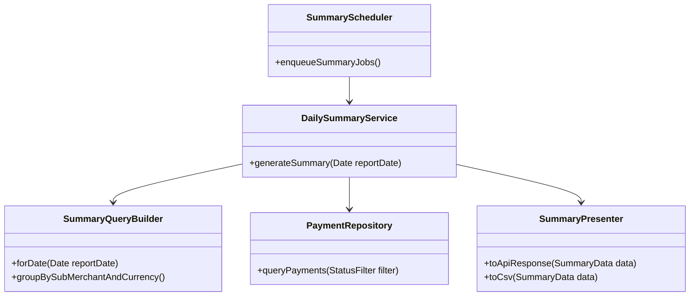

# Summary & Reporting Domain Classes

## Notes

- Summaries are read-only operations that query the payment store without altering state, ensuring ACID writes remain unaffected.
- `DailySummaryService` aggregates by `TransactionStatus` categories defined by the ERD, meeting the business requirements (approved, declined, reversed, refunded).
- Presentation is abstracted so we can add REST, GraphQL, or downstream exports (DRY across output formats).
- The Mermaid styling keeps the scheduler, query builder, and presenter visually distinct so the reporting flow can be read at a glance.
