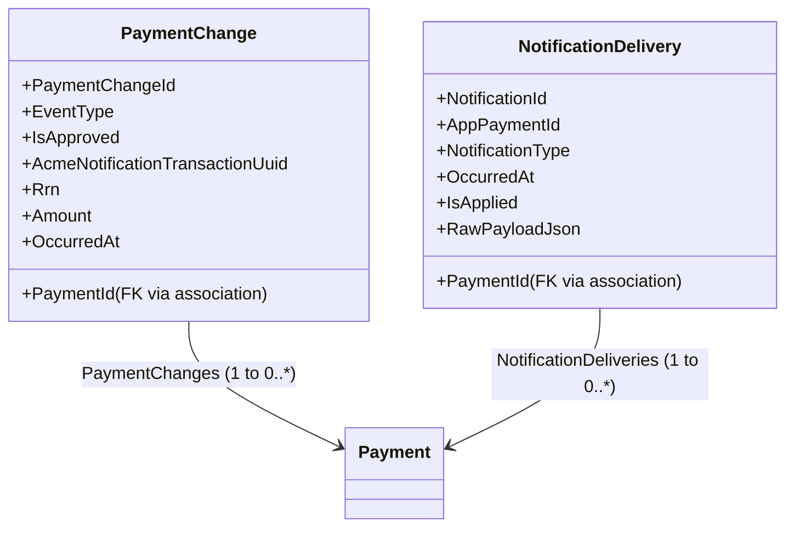
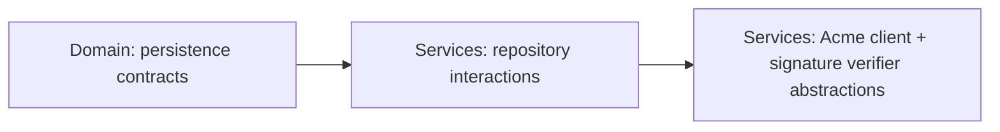

<Callout tone="info">
Wave 2 blockers focus on persistence contracts and handler compilation for Acme notification/payment flows. This design updates the Domain persistence model for <ModelRef application={e477e0b1-f141-4531-b30f-7b53a9b73a52} designer={Domain} element={AcmeIntegreatedAssessement.Domain/PaymentChange} /> and <ModelRef application={e477e0b1-f141-4531-b30f-7b53a9b73a52} designer={Domain} element={AcmeIntegreatedAssessement.Domain/NotificationDelivery} />, and ensures Commands/Queries (T2.7–T2.10) can interact with repositories for <ModelRef application={e477e0b1-f141-4531-b30f-7b53a9b73a52} designer={Domain} element={AcmeIntegreatedAssessement.Domain/Payment} /> plus the two notification/change aggregates.
</Callout>

## Overview
This change adds the missing persistence-side contract (Redis OM repository/document types) for the Domain entities required by Wave 2, and aligns Services CQRS interactions so handlers compile against the generated repository abstractions.

<Callout tone="warning">
<b>Incremental blocker we address</b>: Wave 2 fails because Redis OM persistence abstractions for <ModelRef application={e477e0b1-f141-4531-b30f-7b53a9b73a52} designer={Domain} element={AcmeIntegreatedAssessement.Domain/PaymentChange} /> and <ModelRef application={e477e0b1-f141-4531-b30f-7b53a9b73a52} designer={Domain} element={AcmeIntegreatedAssessement.Domain/NotificationDelivery} /> are incomplete (missing explicit document/repository contracts per designer schema), so T2.7–T2.10 handlers cannot compile.
</Callout>

## Decisions confirmed with the user
<Callout tone="decision">
<b>Design Decision</b>: Realize Redis OM persistence contracts by modelling the Document/Repository layer in the Domain so Software Factory can generate the Redis OM document + repository/document interface needed by Services handlers.

<b>Why:</b> The Services designer rules require appropriate Domain interaction associations; compilation depends on repository abstractions existing (and named) in the generated code.
</Callout>

<Callout tone="decision">
<b>Design Decision</b>: Avoid touching already-ticked model work for T2.5/T2.6 unless needed for compilation correctness.

<b>Why:</b> Incremental constraint from the wave indicates persistence contract gaps only; changing already-green tasks increases regression risk.
</Callout>

## Module & architecture prerequisites
No module installation changes are required for this design.

(Reason: the solution already has <ModelRef application={e477e0b1-f141-4531-b30f-7b53a9b73a52} designer={Domain} element={Intent.Redis.Om.Repositories/Document Db Provider/Redis OM} /> available and installed in the solution module landscape; the blocker is modelling-side contract completeness, not missing Redis OM support.)

## Domain model — aggregate shape

## Per-entity / per-DTO detail
### PaymentChange (persistence contract completion)
<DataModel entity="PaymentChange" role="aggregate root / persistable entity">
- <ModelRef application={e477e0b1-f141-4531-b30f-7b53a9b73a52} designer={Domain} element={AcmeIntegreatedAssessement.Domain/PaymentChange} /> (existing) — add/adjust the persistence-side contract elements so Redis OM generates the expected document + repository abstractions.
</DataModel>

### NotificationDelivery (persistence contract completion)
<DataModel entity="NotificationDelivery" role="aggregate root / persistable entity">
- <ModelRef application={e477e0b1-f141-4531-b30f-7b53a9b73a52} designer={Domain} element={AcmeIntegreatedAssessement.Domain/NotificationDelivery} /> (existing) — add/adjust the persistence-side contract elements so Redis OM generates the expected document + repository abstractions.
</DataModel>

## Endpoints
No new endpoints are introduced in this wave; we align existing Commands/Queries interactions:
- <ModelRef application={e477e0b1-f141-4531-b30f-7b53a9b73a52} designer={Services} element={AcmeIntegreatedAssessement.Services/Commands/ProcessAcmeApprovedNotificationCommand} />
- <ModelRef application={e477e0b1-f141-4531-b30f-7b53a9b73a52} designer={Services} element={AcmeIntegreatedAssessement.Services/Commands/ProcessAcmeReversalNotificationCommand} />
- <ModelRef application={e477e0b1-f141-4531-b30f-7b53a9b73a52} designer={Services} element={AcmeIntegreatedAssessement.Services/Queries/GetPaymentStateQuery} />

## Realization plan
<Table>
| Requirement ID | [model] | [code] | Depends-on |
|---|---|---|---|
| T2.7 | Ensure Redis OM persistence contract exists for <ModelRef application={e477e0b1-f141-4531-b30f-7b53a9b73a52} designer={Domain} element={AcmeIntegreatedAssessement.Domain/PaymentChange} /> so repository/document interface is generated consistently | Generated by SF; no manual code in this design | none |
| T2.7 (impl) | Ensure Services <ModelRef application={e477e0b1-f141-4531-b30f-7b53a9b73a52} designer={Services} element={AcmeIntegreatedAssessement.Services/Commands/ProcessAcmeApprovedNotificationCommand} /> can resolve <ModelRef application={e477e0b1-f141-4531-b30f-7b53a9b73a52} designer={Domain} element={AcmeIntegreatedAssessement.Domain/PaymentChange} /> repository | Model DTO/interaction wiring only | T2.7 |

| T2.8 | Ensure Redis OM persistence contract exists for <ModelRef application={e477e0b1-f141-4531-b30f-7b53a9b73a52} designer={Domain} element={AcmeIntegreatedAssessement.Domain/NotificationDelivery} /> so repository/document interface is generated consistently | Generated by SF; no manual code in this design | none |
| T2.8 (impl) | Ensure Services <ModelRef application={e477e0b1-f141-4531-b30f-7b53a9b73a52} designer={Services} element={AcmeIntegreatedAssessement.Services/Commands/ProcessAcmeReversalNotificationCommand} /> can resolve <ModelRef application={e477e0b1-f141-4531-b30f-7b53a9b73a52} designer={Domain} element={AcmeIntegreatedAssessement.Domain/NotificationDelivery} /> repository | Model DTO/interaction wiring only | T2.8 |
| T2.9 | Ensure Commands/Queries interaction associations allow handlers to resolve repositories for <ModelRef application={e477e0b1-f141-4531-b30f-7b53a9b73a52} designer={Domain} element={AcmeIntegreatedAssessement.Domain/Payment} />, <ModelRef application={e477e0b1-f141-4531-b30f-7b53a9b73a52} designer={Domain} element={AcmeIntegreatedAssessement.Domain/NotificationDelivery} />, <ModelRef application={e477e0b1-f141-4531-b30f-7b53a9b73a52} designer={Domain} element={AcmeIntegreatedAssessement.Domain/PaymentChange} /> | Generated by SF; no manual code in this design | T2.7, T2.8 |
| T2.10 | Ensure missing Acme stub client abstraction and notification signature verifier abstraction are modelled so handler constructor/DI signatures compile | Model DTO/contracts/proxy abstractions (or ignore-protected code hooks if unavoidable) | T2.9 |
</Table>

## Modelling order

## Code placement
- Persistence contract adjustments are model-only; Software Factory generates Redis OM repositories/documents.
- Commands/Queries interaction fixes are model-only; handler compilation depends on generated repo abstractions.
- Abstractions for Acme client stub + signature verification must be modelled in Services/Domain as appropriate so handlers compile (no handler body logic in this design).

## Assumptions
<Checklist>
- [ ] Redis OM module is already installed for this application; design focuses on missing persistence-side contracts.
- [ ] No changes are required to T2.5/T2.6 model work.
- [ ] Existing Services CQRS operations for T2.7–T2.10 already exist; we only update their domain interaction associations / required DI constructor surface.
- [ ] The only Wave 2 correctness requirement is compilation (and that the persistence abstractions exist for the handlers); business logic bodies are handled by the coding wave.
</Checklist>
